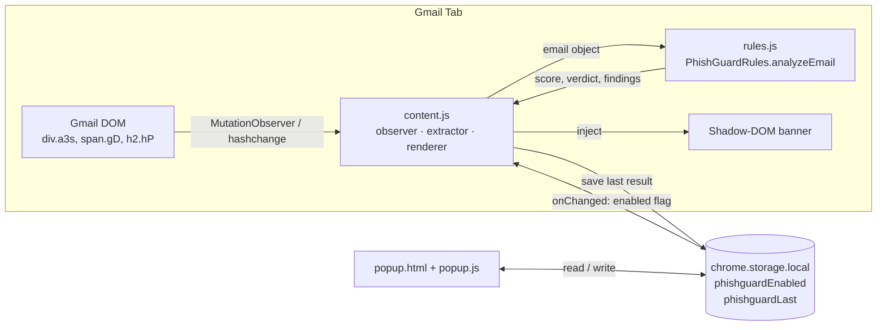
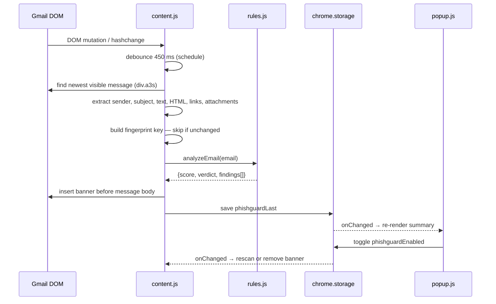

# PhishyPhish — Gmail Phishing Detector (Chrome Extension)

A Manifest V3 Chrome extension that scans the email you have open in Gmail and shows a colour-coded risk banner above the message. Detection is **rule-based and 100% local**: no servers, no API calls, no email content leaves your browser.

> Note: the manifest names the extension **"PhishyPhish"**, while the popup, code and storage keys use **"PhishGuard"**. This README uses PhishGuard; see [Improvements](#6-suggested-improvements) to unify the naming.

---

## 1. Features

| Area | What it detects |
|---|---|
| **Sender** | Raw-IP sender, punycode/homoglyph domains, high-abuse TLDs (`.tk`, `.zip`, `.xyz`…), brand impersonation (display name says "PayPal" but domain isn't), typosquatting (Levenshtein distance ≤ 2 from a known brand), display name showing a different email/domain |
| **Links** | Link text vs. real destination mismatch, `user@host` URL tricks, raw-IP links, punycode, URL shorteners, high-abuse TLDs, non-HTTPS, brand name inside a foreign domain, `javascript:`/`data:` URLs, very long/deep hosts |
| **Content** | Urgency, threats, credential requests, "verify your account", prizes, finance/invoice bait, generic greetings, secrecy, "click here"; a combo rule (pressure + credentials + link); deliberate misspellings; ALL-CAPS / `!!!`; embedded password inputs; CSS-hidden links |
| **Attachments** | Executables (`.exe`, `.js`, `.vbs`, `.iso`…), macro documents (`.docm`, `.xlsm`), HTML/SVG attachments, archives, double extensions (`invoice.pdf.exe`) |

Output: a verdict (**Safe / Suspicious / Phishing likely**), a 0–100 risk score, and the list of triggered signals.

---

## 2. Install & use in Chrome

The extension is not on the Chrome Web Store, so load it as an unpacked extension.

1. **Get the code.** Unzip the project so you have a folder containing `manifest.json`, `content.js`, `rules.js`, `popup.html`, `popup.js`, `styles.css`.
   (Ignore `__MACOSX/` and `.git/` if present.)
2. Open Chrome and go to **`chrome://extensions`**.
3. Turn on **Developer mode** (top-right toggle).
4. Click **Load unpacked** and select the `phishing-email-analyser` folder (the one that contains `manifest.json`).
5. (Optional) Click the puzzle-piece icon and **pin** the extension.
6. Open **https://mail.google.com** and open any email.
7. A banner appears **above the message body**:
   - 🟢 **No strong phishing signals** — collapsed by default; click to expand.
   - 🟡 **Suspicious email** — score 10–29.
   - 🔴 **Phishing likely** — score ≥ 30.
   Click the banner header to expand/collapse the list of signals.
8. Click the extension's toolbar icon to **enable/disable** scanning and see the last scan summary (verdict, score, sender, subject).

**After editing code:** go to `chrome://extensions`, click the ⟳ reload icon on the extension, then **refresh the Gmail tab** (content scripts only inject on page load).

**Troubleshooting**

| Problem | Fix |
|---|---|
| No banner appears | Reload the extension, hard-refresh Gmail, confirm the toggle in the popup is on, and make sure an email is actually *open* (not just the inbox list). |
| Banner shows on the wrong message | Gmail threads show several messages; the scanner analyses the newest visible one. |
| Errors | `chrome://extensions` → extension → **Errors**, or DevTools console on the Gmail tab. |

**Testing safely:** send yourself an email with e.g. the subject "URGENT: verify your account", body "Your account will be suspended immediately. Click here to confirm your password", and a link whose text is `paypal.com` but points to another domain. Do not open real malicious attachments.

---

## 3. Architecture

### 3.1 File layout

```
phishing-email-analyser/
├── manifest.json   # MV3 config: permissions, content-script injection, popup
├── rules.js        # Detection engine (pure functions, no DOM/network)  -> PhishGuardRules
├── content.js      # Runs inside Gmail: DOM scraping, scheduling, banner UI
├── styles.css      # Injected CSS (banner itself is styled inside Shadow DOM)
├── popup.html      # Toolbar popup UI
└── popup.js        # Popup logic: on/off toggle + last-scan summary
```

### 3.2 Component diagram



Components talk **only through `chrome.storage.local`** — there is no background service worker and no message passing.

### 3.3 Runtime flow



### 3.4 Module responsibilities

**`manifest.json`** — Requests only `storage` and host access to `https://mail.google.com/*`. Injects `rules.js` then `content.js` (order matters: `content.js` uses the global `PhishGuardRules`) at `document_idle`.

**`content.js`** (the Gmail integration layer)
- *Boot:* reads the enabled flag, listens for toggle changes, observes the whole document with a `MutationObserver` (Gmail is a single-page app) plus `hashchange`.
- *Scheduling:* debounces scans (450 ms) so rapid DOM churn triggers one scan.
- *Extraction:* finds the newest visible `div.a3s` (message body); reads the sender from `span.gD[email]`; subject from `h2.hP`; collects links (unwrapping Gmail's `google.com/url?q=` redirector so the *real* destination is analysed); attachment names from `a[download]` / tooltips; counts CSS-hidden links.
- *De-duplication:* builds a fingerprint (`sender|subject|length|first 120 chars|link count|attachments`) and skips re-analysis if unchanged and the banner still exists.
- *Rendering:* an isolated **Shadow DOM** host so Gmail's CSS can't affect the banner and vice-versa; all dynamic text is HTML-escaped.

**`rules.js`** (the detection engine) — A pure, side-effect-free module exposing `analyzeEmail(email)` — easy to unit-test in Node.
- Reference data: free mail providers, suspicious TLDs, URL shorteners, 30 brands + official domains, multi-part public suffixes, dangerous extensions.
- Four checkers append *findings* `{level, category, message, weight}` via a shared `add()` callback: `checkSender`, `checkLinks`, `checkText`, `checkAttachments`.

**`popup.js`** — Toggle (writes `phishguardEnabled`) and a live summary (reads `phishguardLast`, listens to `onChanged`).

### 3.5 Scoring logic

```
score   = min(100, Σ finding.weight)
verdict = score ≥ 30 → dangerous
          score ≥ 10 → suspicious
          otherwise  → safe
```

Each finding carries a weight reflecting how strong the signal is, for example:

| Signal | Weight |
|---|---|
| Executable attachment / raw-IP sender / `@` in URL / password field | 30 |
| Brand impersonation (display name or domain) | 28–30 |
| Link text domain ≠ real link domain | 28 |
| Typosquatting (≤ 2 edits from a brand) | 28 |
| Pressure + credentials + link combo | 16 |
| Credential words / verify / threat / urgency language | 7–11 (+2 per extra distinct phrase, capped) |
| High-abuse TLD | 10 |
| Non-HTTPS link, ALL-CAPS, many `!` | 3–4 |

Link findings are sorted by weight, de-duplicated, and capped at 6 shown (remainder summarised). The banner displays the top 10 findings.

**Registrable-domain logic:** `registrableDomain()` takes the last two labels, or three when the suffix is in `MULTI_SUFFIX` (e.g. `co.uk`). This is a lightweight stand-in for the Public Suffix List.

---

## 4. Privacy & security model

- All analysis happens in the page; no `fetch`/XHR anywhere.
- Only `storage` permission; scoped to `mail.google.com`.
- Stored locally: enabled flag and the last scan summary (sender, subject up to 60 chars shown, score).
- Dynamic strings are escaped before insertion into HTML.

---

## 5. Known limitations

- **Heuristics only** — it can miss well-written phishing and flag legitimate marketing/notification mail.
- **Fragile Gmail selectors** (`div.a3s`, `span.gD`, `h2.hP`, `div.adn`) are obfuscated internal class names that Google can change at any time.
- Does **not** see raw headers (SPF/DKIM/DMARC, Reply-To, Return-Path, Received chain).
- Does not follow links, resolve shorteners, or scan attachment contents.
- Only the newest message of a thread is analysed.
- Gmail web only (no Outlook, Yahoo, mobile).

---


## 6. Disclaimer

PhishGuard is a heuristic aid, not a guarantee of safety. Always verify unexpected requests through a separate channel and report suspected phishing to your email provider or IT team.